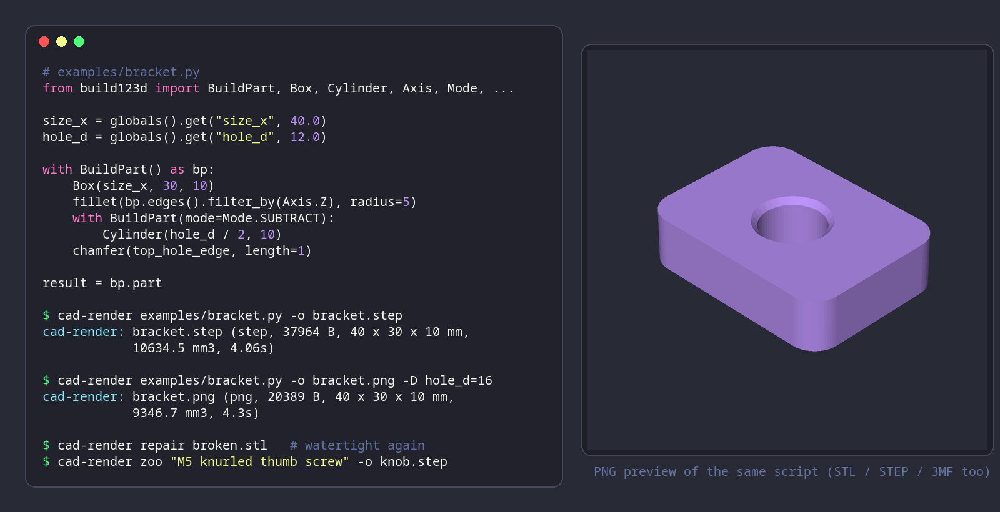

# cad-render

[](https://github.com/rojosinalma/cad-render/actions/workflows/run-tests.yml)
[](https://github.com/rojosinalma/cad-render/actions/workflows/publish-image.yml)
[](https://github.com/rojosinalma/cad-render/releases)
[](LICENSE)



Headless B-rep CAD as an HTTP service: turn [build123d](https://build123d.readthedocs.io) scripts into
STL / STEP / 3MF / PNG, convert and repair meshes, and generate CAD from a text prompt — made for
agents and scripts, one Docker container, file in / file out.

Parts are modelled in Python with build123d on OpenCascade, so fillets, chamfers and threads are exact
and STEP goes in and out. The service is stateless: one request is one file, results come back with
`X-Cad-*` headers (volume, bounding box, warnings, seconds) or as JSON with the worker log, and the CLI
reports distinct exit codes (`3` = empty geometry, which makes a fit check a one-liner). Text-to-CAD via
[Zoo](https://zoo.dev) and the hand-off to a [Bambuddy](https://github.com/maziggy/bambuddy) library
and slicer pipeline are both optional. The CLI, the API, writing parts, configuration, security and
development are documented in `docs/`.

## Requirements

- Docker 24 or newer with the Compose plugin v2 (the image is published for `linux/amd64` and
  `linux/arm64`).
- For the `bin/cad-render` CLI on the client: `bash` 4+, `curl` 7.x+, `tar` and `ruby` 3.0+.
- Optional: a [Zoo](https://zoo.dev) API token for `/zoo`; a Bambuddy URL and API key for `--to-bb`.

## Installation

```sh
git clone https://github.com/rojosinalma/cad-render.git
cd cad-render
cp .env.example .env            # add ZOO_API_TOKEN only if you want /zoo
docker compose up -d            # pulls ghcr.io/rojosinalma/cad-render:latest
curl http://localhost:9292/health
```

Pin a release with `CAD_IMAGE_TAG=<version>` in `.env`. Put `bin/cad-render` on your `PATH` and set
`CAD_RENDER_URL` if the service runs elsewhere. Every setting is an environment variable; see
[docs/configuration.md](docs/configuration.md).

## Usage

```sh
bin/cad-render examples/bracket.py -o bracket.stl          # render a part
bin/cad-render examples/bracket.py -o bracket.png -D hole_d=8  # PNG preview with a define
bin/cad-render convert bracket.step -o bracket.3mf          # STEP → 3MF
bin/cad-render repair broken.stl -o fixed.stl               # mesh repair, reports watertightness
bin/cad-render zoo "M3 heat-set insert boss, 6 mm tall" -o boss.step
```

The same operations are plain HTTP (`POST /render`, `/convert`, `/repair`, `/zoo`); see
[docs/cli.md](docs/cli.md), [docs/api.md](docs/api.md) and [docs/writing-parts.md](docs/writing-parts.md).

## Development

```sh
cp compose.override.yaml.example compose.override.yaml   # local build, live reload
docker compose up -d --build
bin/verify                                               # smoke contract against localhost:9292
```

Layout, locking and the image build are in [docs/development.md](docs/development.md); how to
contribute in [CONTRIBUTING.md](CONTRIBUTING.md).

## License

[AGPL-3.0](LICENSE) — Copyright (C) 2026 rojosinalma.
